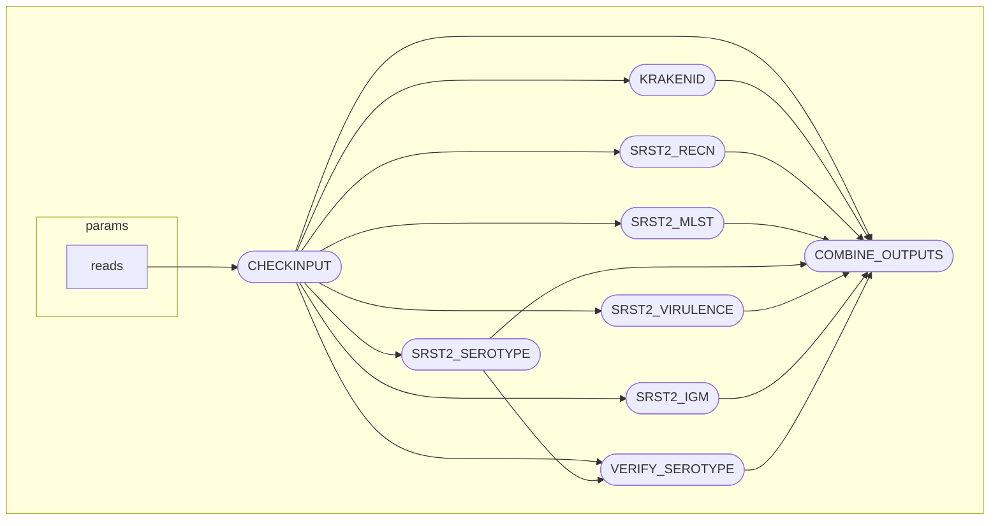

[](https://github.com/aphascience/Strepsuis_seq/actions/workflows/maintest.yml)


## **Strepsuis_seq**

This is the repo for APHA's Nextflow implementation of the [_Streptococcus suis_ serotyping pipeline](https://github.com/streplab/SsuisSerotyping_pipeline).  It essentially makes use of SRST2 to map reads to mlst, virulence and serotyping databases. To reduce running time input files are downsampled if required and Kraken2 is used to confirm species ID alongside the presence of a recN allele thought to be species-specific.  Some serotypes can only be differentiated based on a single SNP and this is achieved using a bespoke module.

Calculations of best match are in the [SRST2 publication](
https://genomemedicine.biomedcentral.com/articles/10.1186/s13073-014-0090-6)

srst2 processes are run in parallel and all data are collated into a final output file.



# Quick start

As this pipeline has been built in Nextflow, there are minimal requirements to get started.  The only prerequisites are [Nextflow](https://www.nextflow.io/) (requires Java >= v17) and [Docker](https://www.docker.com/). Then the pipeline can be run using the following:

```
nextflow run aphascience/Strepsuis_seq/ -with-docker <docker_registry/imagename> --reads <path_to _reads/*_{S*_R1,S*_R2}*.fastq.gz>
```
The Dockerfile in the repository contains all the information needed to build the image with required software tools, and the relevent databases for srst2 are in the 'assets' directory.

# Databases

_Streptococcus suis_ MLST database last updated 01-Oct-25 from: [_Streptococcus suis_ pubMLST](https://pubmlst.org/organisms/streptococcus-suis)

recN, virulence and serotype databases are obtained from: [_Streptococcus suis_ serotyping pipeline](https://github.com/streplab/SsuisSerotyping_pipeline)

Additional virulence genes are:  
virA: [SSU1589 from _Streptococcus suis_ P1/7](https://www.ncbi.nlm.nih.gov/nuccore/AM946016.1?from=1597720&to=1598925)  
GI3: [Genomic Island 3 from _Streptococcus suis_ P1/7](https://www.ncbi.nlm.nih.gov/nuccore/AM946016.1?from=195886&to=197085)

The IgM protease gene is a putative virulence factor and alleles present in an isolate can be used to predict the cross-protection that can be expected from a group A based IgM protease vaccine [Jacobs _et. al._, 2024](https://link.springer.com/article/10.1186/s40813-024-00398-2).  Following clusetering of available alleles representative sequences (IgM-A1, IgM-A2, IgM-C1, IgM-C2, IgM-C3, IgM-B1, IgM-B2, and IgM-B3) have been designated.

Kraken2 uses the [minikraken2 v1 database](https://genome-idx.s3.amazonaws.com/kraken/minikraken2_v1_8GB_201904.tgz)

# CI testing

Testing has been built using the [nf-test](https://www.nf-test.com/) framework and ensures that each module performs as expected
